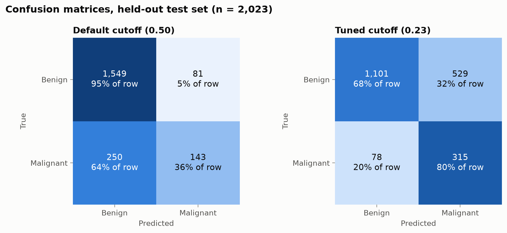
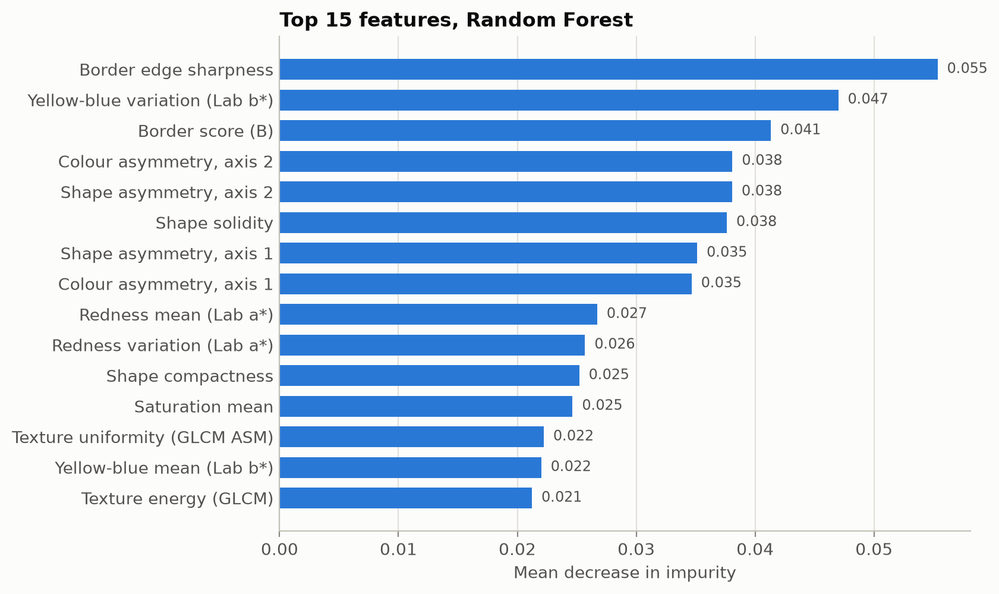
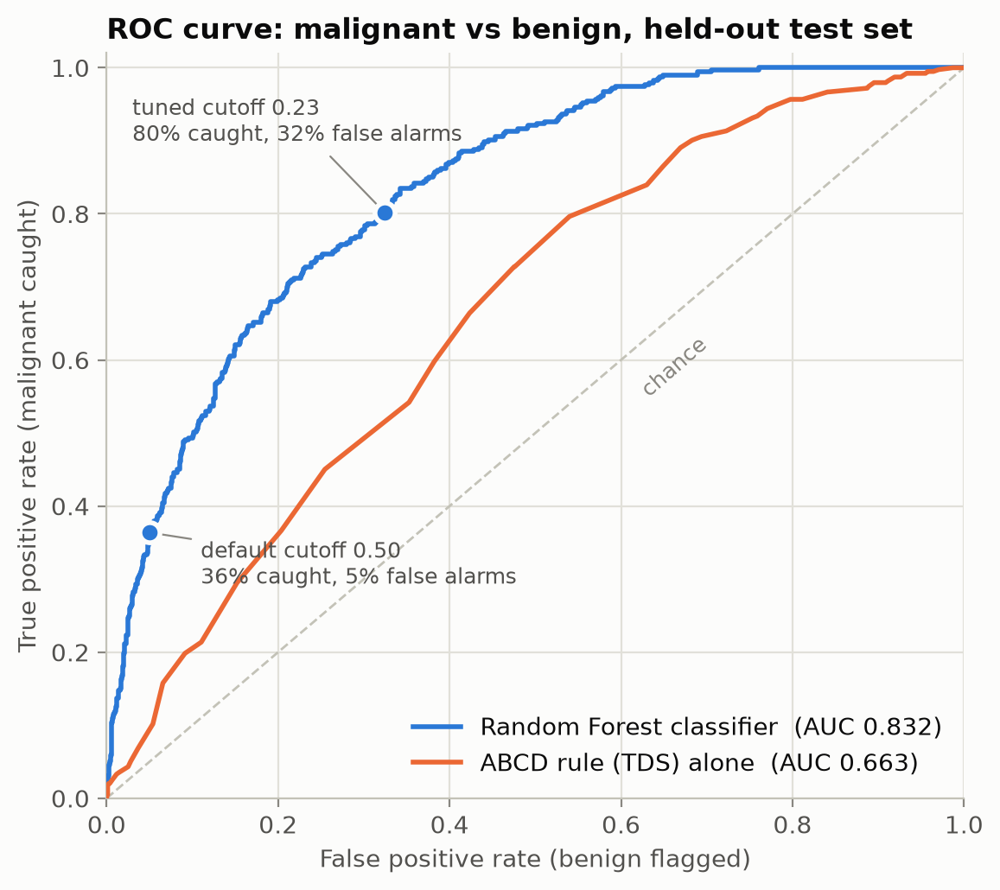
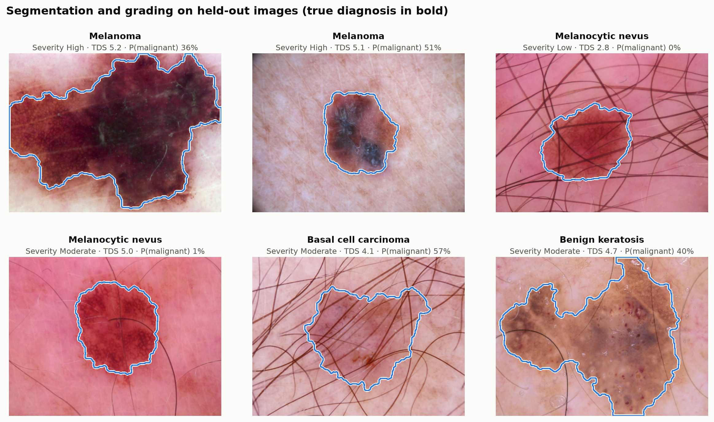
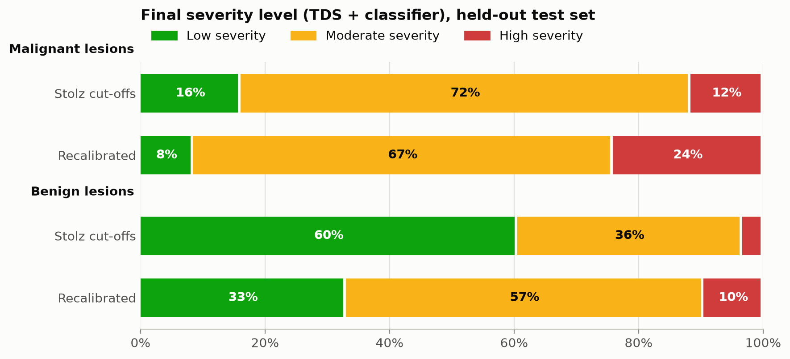
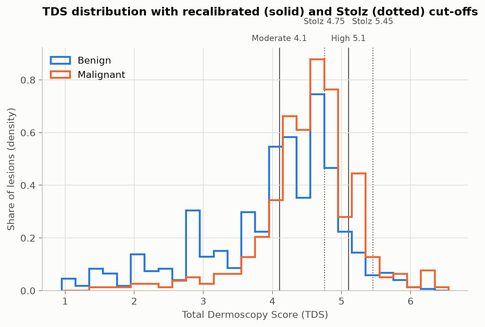

# Results (held-out test set)

Test images: 2,023 (393 malignant, 1,630 benign), split by lesion_id from 10,008 featurized HAM10000 images. Generated by `evaluate.py`.

## Classifier

- Malignancy ROC-AUC: **0.832** (ABCD/TDS alone: 0.663)

| Cutoff | Malignant caught (recall) | Precision | Benign flagged | Accuracy |
|---|---|---|---|---|
| Default 0.50 | 36.4% (143/393) | 63.8% | 5.0% | 83.6% |
| Tuned 0.229 | 80.2% (315/393) | 37.3% | 32.5% | 70.0% |

## Severity levels

TDS cut-offs: Stolz 4.75 / 5.45, recalibrated 4.1 / 5.1.

| Group | Low | Moderate | High |
|---|---|---|---|
| Malignant, Stolz | 16.0% | 72.3% | 11.7% |
| Benign, Stolz | 60.5% | 36.1% | 3.4% |
| Malignant, Recalibrated | 8.4% | 67.4% | 24.2% |
| Benign, Recalibrated | 32.9% | 57.5% | 9.6% |

## Figures

